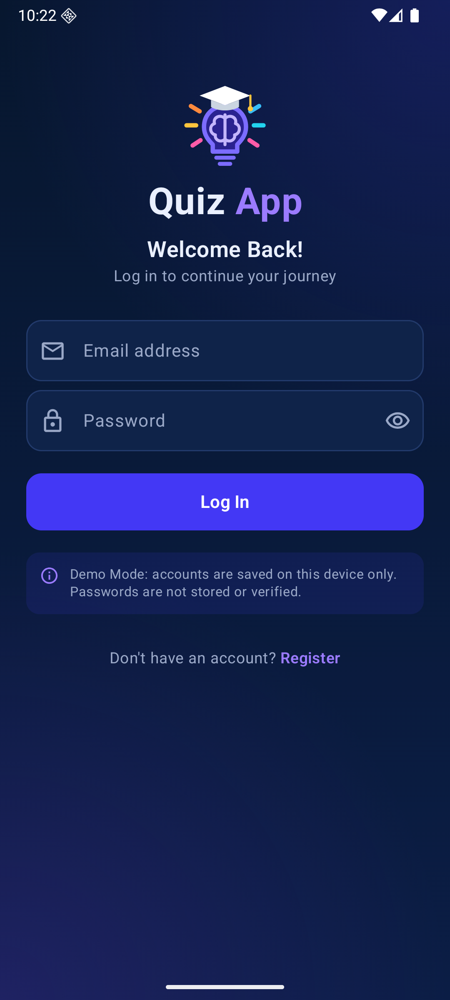
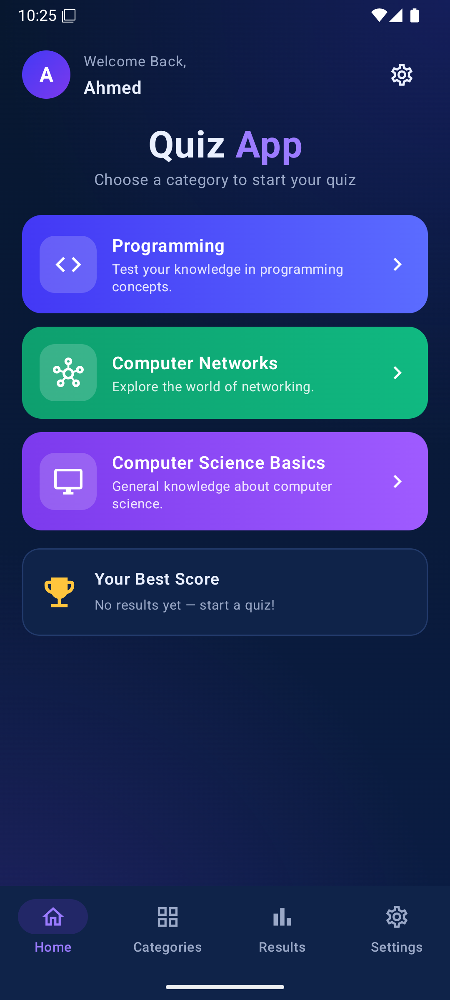
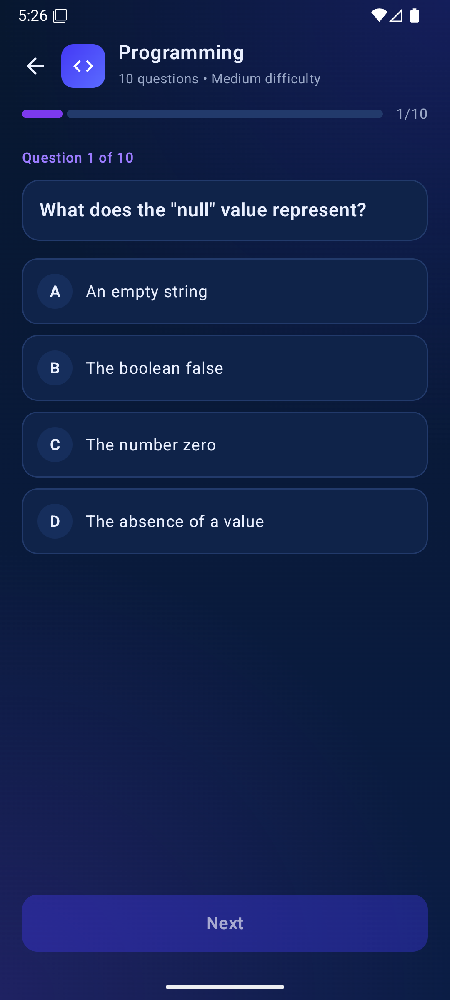
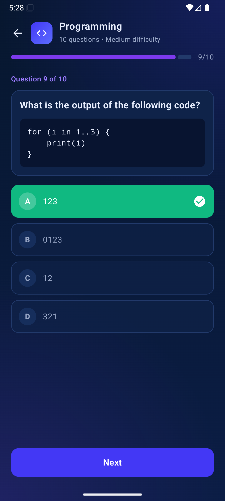
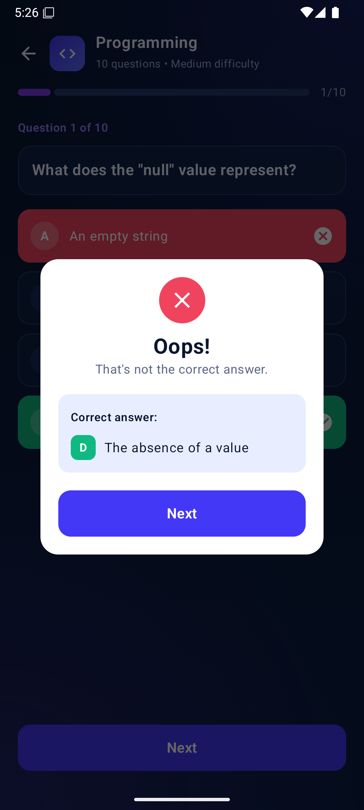
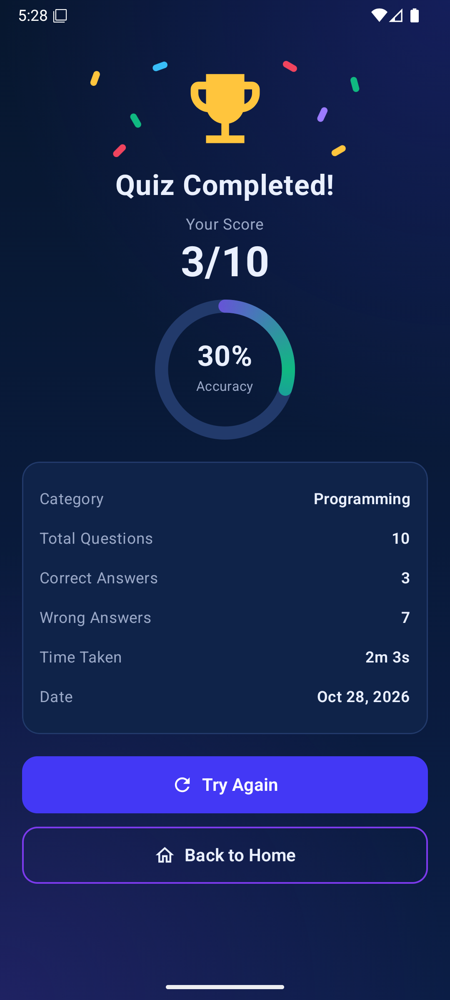
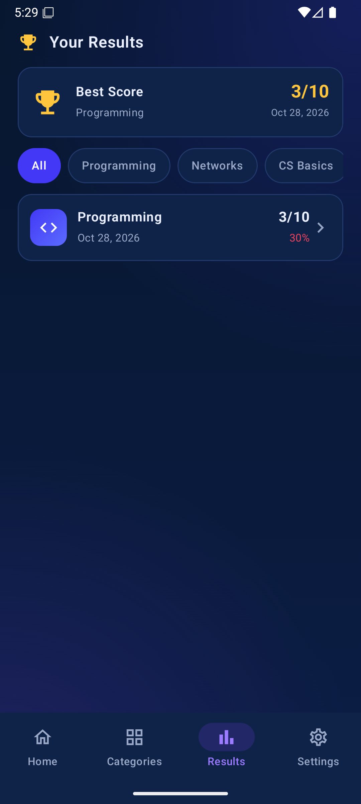
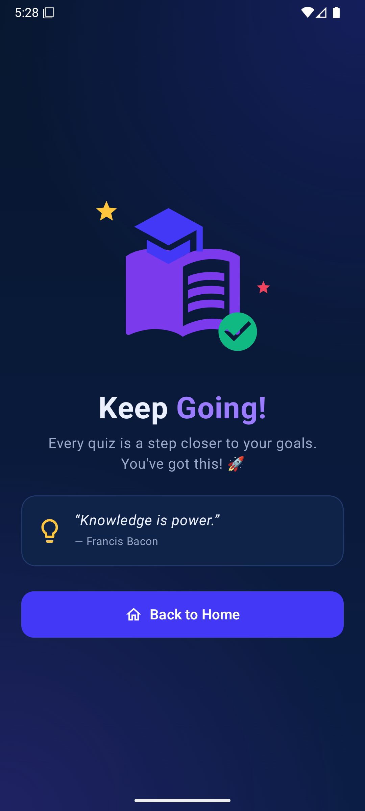
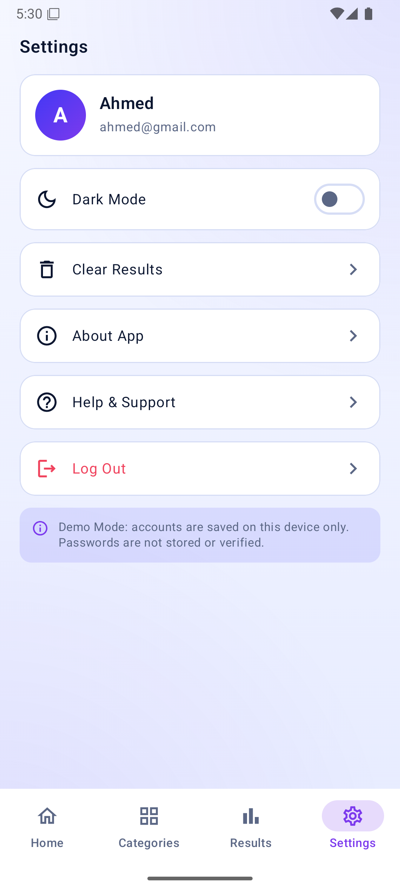
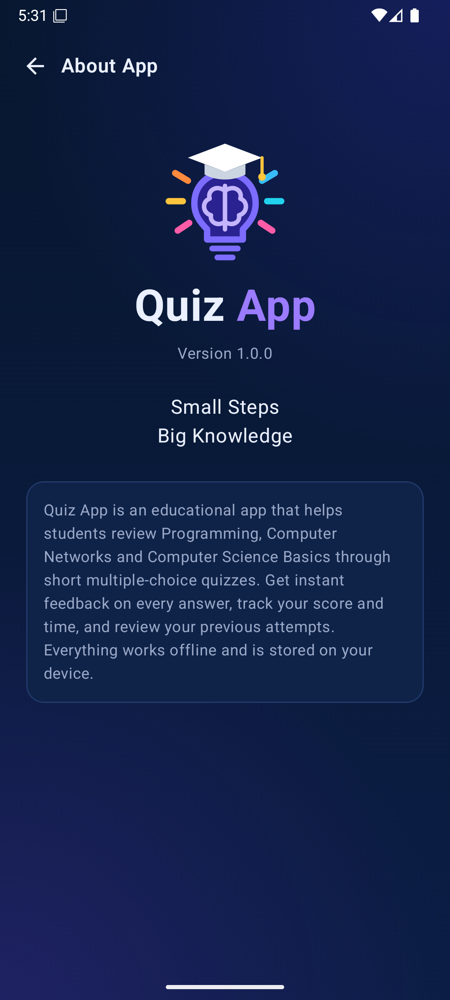

# Quiz App 🧠

**Small Steps, Big Knowledge**

تطبيق Android تعليمي فيه اختبارات اختيار من متعدد (MCQ) في البرمجة والشبكات وأساسيات علوم الكمبيوتر. متعمل بـ Kotlin و Jetpack Compose.

<p>





</p>
<p>





</p>

---

## المحتويات
1. [المتطلبات](#1-المتطلبات)
2. [تنزيل المشروع](#2-تنزيل-المشروع)
3. [فتح المشروع وتشغيله في Android Studio](#3-فتح-المشروع-وتشغيله-في-android-studio)
4. [التشغيل على موبايل حقيقي](#4-التشغيل-على-موبايل-حقيقي)
5. [التشغيل من الـTerminal](#5-التشغيل-من-الـterminal-اختياري)
6. [مميزات التطبيق](#6-مميزات-التطبيق)
7. [تنظيم الكود](#7-تنظيم-الكود)
8. [قرارات التنفيذ](#8-قرارات-التنفيذ)
9. [مشاكل شائعة وحلها](#9-مشاكل-شائعة-وحلها)
10. [الشغل كفريق على GitHub](#10-الشغل-كفريق-على-github)

---

## 1. المتطلبات

| الحاجة | التفاصيل |
|---|---|
| **Android Studio** | أي نسخة حديثة (Narwhal أو أحدث). نزّلها من [developer.android.com/studio](https://developer.android.com/studio) |
| **JDK 17+** | بيجي جاهز جوه Android Studio، مش محتاج تنزله لوحده |
| **Android SDK 36** | Android Studio هيعرض ينزله أول ما تفتح المشروع |
| **إنترنت** | أول مرة بس، عشان Gradle ينزل المكتبات |
| **جهاز للتشغيل** | Emulator من Android Studio، أو موبايل Android 8.0 (API 26) أو أحدث |

---

## 2. تنزيل المشروع

**الطريقة الأولى: Git (الأفضل)**
```bash
git clone https://github.com/gabal-ahmed/quiz-app.git
cd quiz-app
```

**الطريقة التانية: من غير Git**
1. افتح صفحة الـrepo على GitHub.
2. دوس على الزرار الأخضر **Code** وبعدين **Download ZIP**.
3. فك الضغط في أي فولدر. يُفضّل يكون مساره من غير مسافات أو حروف عربي، زي `C:\Projects\quiz-app`.

---

## 3. فتح المشروع وتشغيله في Android Studio

1. افتح Android Studio واختار **File > Open** (أو **Open** من شاشة البداية).
2. اختار فولدر المشروع (`quiz-app`)، وهو الفولدر اللي فيه `settings.gradle.kts`، ودوس **OK**.
3. لو سألك **Trust Project?** اختار **Trust Project**.
4. استنى الـ**Gradle Sync** يخلص، وتقدر تتابعه في الشريط اللي تحت. أول مرة ممكن ياخد من 2 لـ 5 دقايق.
   - لو طلع إن SDK 36 مش موجود، دوس على الرسالة اللي فيها **Install** أو روح **Tools > SDK Manager** وعلّم على **Android 16 (API 36)**.
5. جهّز Emulator لو مش عندك:
   - **Tools > Device Manager**، بعدين **+**، بعدين **Create Virtual Device**.
   - اختار موبايل (مثلًا **Pixel 8**) وبعدين **Next**، واختار System Image حديثة ونزّلها، وبعدين **Finish**.
6. من الشريط اللي فوق اختار الـModule **app** والجهاز، ودوس ▶️ **Run** (أو `Shift + F10`).
7. التطبيق هيفتح على شاشة الـSplash وبعدها Login.

### أول استخدام
- دوس **Register** واعمل حساب بأي اسم وإيميل وباسورد (6 حروف على الأقل).
- هتدخل على Home على طول. اختار تصنيف وابدأ الاختبار.
- بعد كده تقدر تعمل Log Out من Settings وتدخل تاني بنفس الإيميل.

> ⚠️ التطبيق شغال بـ **Demo Mode**: الحسابات بتتحفظ على الجهاز بس، والباسورد مش بيتحفظ ولا بيتراجع. التفاصيل في [قرارات التنفيذ](#8-قرارات-التنفيذ).

---

## 4. التشغيل على موبايل حقيقي

1. على الموبايل افتح **Settings > About phone** ودوس على **Build number** سبع مرات عشان يتفعّل **Developer options**.
2. ادخل **Developer options** وشغّل **USB debugging**.
3. وصّل الموبايل بالكمبيوتر بالكابل، ووافق على رسالة **Allow USB debugging** اللي هتظهر على الموبايل.
4. هتلاقي الموبايل ظهر في قايمة الأجهزة في Android Studio. اختاره ودوس ▶️ **Run**.

**أو ثبّت الـAPK على طول:** اعمل Build للـAPK (شوف الجزء الجاي) وابعت ملف `app-debug.apk` للموبايل وافتحه. هتحتاج تسمح بـ"التثبيت من مصادر غير معروفة".

---

## 5. التشغيل من الـTerminal (اختياري)

لازم يكون `JAVA_HOME` شايل على JDK 17 أو أحدث. أسهل حل إنك تستخدم الـJDK اللي جاي مع Android Studio:

```powershell
# Windows (PowerShell)
$env:JAVA_HOME = "C:\Program Files\Android\Android Studio\jbr"

.\gradlew.bat assembleDebug        # يبني الـAPK
.\gradlew.bat testDebugUnitTest    # يشغّل الـunit tests
.\gradlew.bat installDebug         # يثبّت على الجهاز/الـEmulator المتوصل
```

```bash
# macOS / Linux
export JAVA_HOME="/Applications/Android Studio.app/Contents/jbr/Contents/Home"   # macOS
./gradlew assembleDebug
./gradlew testDebugUnitTest
```

الـAPK بيطلع هنا: `app/build/outputs/apk/debug/app-debug.apk`

**الـUnit tests الموجودة** (في `app/src/test`):
- كل تصنيف فيه 10 أسئلة، وترتيب الاختيارات العشوائي مبيغيّرش الإجابة الصح.
- النتيجة = الإجابات الصح ÷ إجمالي الأسئلة × 100.
- مفيش إجابة بتتحسب مرتين، وزرار Next مش بيشتغل غير بعد ما تختار إجابة.
- المحاولة بتتحفظ مرة واحدة بس، وبالنتيجة والوقت الصح.
- أفضل نتيجة بتتحسب صح.

---

## 6. مميزات التطبيق

| الشاشة | اللي بتعمله |
|---|---|
| **Splash** | بتعرض شعار التطبيق ثانية، وبعدين بتوديك Home لو انت مسجّل دخول، أو Login لو لأ |
| **Login / Register** | التحقق من الحقول: الاسم مطلوب، صيغة الإيميل، الباسورد 6 حروف على الأقل، وتطابق الباسوردين، مع رسالة واضحة لكل خطأ |
| **Home** | ترحيب باسمك، و3 كروت للتصنيفات، وكارت Best Score |
| **Categories** | التصنيفات، مع عدد الأسئلة والصعوبة وأفضل نتيجة لكل تصنيف |
| **Quiz** | 10 أسئلة مترتبة عشوائي. بتختار إجابة واحدة ومش بتتغير، والصح بيبان أخضر، و Next مقفول لحد ما تجاوب |
| **Wrong Answer** | رسالة "Oops!" فوق السؤال، وفيها الإجابة الصح |
| **Results** | النتيجة (8/10)، والنسبة المئوية، والوقت، وزرارين Try Again و Back to Home |
| **Keep Going** | بتظهر لو النتيجة أقل من 70% |
| **Results History** | كل المحاولات، وفلاتر لكل تصنيف، وأفضل نتيجة. لو مفيش محاولات بيظهر "No results yet" |
| **Settings** | Dark/Light Mode (بيتحفظ)، و Clear Results (بتأكيد)، و About، و Help، و Log Out |
| **About** | الشعار، والإصدار 1.0.0، ووصف للتطبيق |

الداتا كلها بتتحفظ على الجهاز، والتطبيق شغال من غير إنترنت. النتايج بتفضل موجودة حتى لو قفلت التطبيق وفتحته.

---

## 7. تنظيم الكود

```
app/src/main/java/com/example/quizapp/
├── MainActivity.kt              # نقطة البداية + الثيم (Dark/Light)
├── QuizApplication.kt           # AppContainer: بيجهّز الـRepositories مرة واحدة
├── navigation/
│   └── AppNavigation.kt         # كل الـRoutes + الـBottom Navigation Bar
├── data/
│   ├── Question.kt              # Category + Question model
│   ├── QuestionBank.kt          # الـ30 سؤال (عدّل أو زوّد أسئلة من هنا)
│   ├── QuizAttempt.kt           # Room Entity لكل محاولة
│   ├── AppDatabase.kt           # Room Database + DAO
│   ├── ResultRepository.kt      # حفظ وقراءة النتايج + حساب النسبة
│   ├── SettingsDataStore.kt     # DataStore: الوضع الداكن + الجلسة
│   └── DemoAuthRepository.kt    # تسجيل الدخول المحلي (Demo Mode)
└── ui/
    ├── theme/Theme.kt           # ألوان التصميم (Navy, Blue, Purple, ...)
    ├── components/Components.kt # عناصر مشتركة: أزرار، كروت، TextField، ...
    ├── splash/   auth/   home/   categories/
    ├── quiz/                    # QuizScreen + QuizViewModel + AnswerFeedbackDialog
    ├── results/                 # ResultScreen + ResultsHistoryScreen + ViewModels
    ├── settings/                # SettingsScreen + AboutScreen
    └── keepgoing/
```

**التقنيات:** Kotlin، و Jetpack Compose (Material 3)، و Navigation Compose، و Room، و DataStore Preferences، و ViewModel مع StateFlow. أقل إصدار Android مدعوم 8.0 (minSdk 26).

### إزاي تزوّد أسئلة؟
افتح `data/QuestionBank.kt` وضيف سطر جديد زي ده:
```kotlin
Question(31, PROGRAMMING, "نص السؤال؟", listOf("اختيار 1", "اختيار 2", "اختيار 3", "اختيار 4"), correctAnswerIndex = 0),
```
الـ`id` لازم يكون مش متكرر، ولازم يبقى فيه 4 اختيارات بالظبط. `correctAnswerIndex` بيبدأ من 0. الاختبار هيعرض كل أسئلة التصنيف.

---

## 8. قرارات التنفيذ

دي حاجات اتحددت هنا لأن وثيقة المواصفات سابت الاختيار للفريق:

- **تسجيل الدخول بـ Demo Mode:** مفيش Firebase متظبط، فالحسابات (الاسم والإيميل بس) بتتحفظ على الجهاز. **الباسورد مش بيتحفظ خالص**، زي ما الوثيقة طلبت إننا منخزنش باسوردات يدوي. ولو عايزين حسابات حقيقية، بدّلوا `DemoAuthRepository` بـ Firebase Authentication.
- **حاجات مش معمولة** (عشان الوثيقة قالت متحطوش زراير مش شغالة): Continue with Google، و Forgot password، و Notifications.
- **Wrong Answer:** رسالة فوق شاشة الاختبار بدل ما تبقى شاشة لوحدها، والوثيقة سامحة بكده.
- **Final Brand:** مش معمولة، عشان الـSplash ميظهرش مرتين، وشاشة About بتغطيها.
- **إضافات:** Log Out، وتأكيد لو خرجت من الاختبار في النص (والمحاولة دي مش بتتحفظ)، والأسئلة والاختيارات بتترتب عشوائي في كل محاولة.

**أخطاء اتصلحت في التصميم المرجعي:**
- في شاشة الإجابة الغلط في التصميم، السؤال عن "keyword لإنشاء class" والإجابة المكتوبة "To initialize the class properties"، ودول مش متوافقين. الأسئلة هنا متوافقة مع إجاباتها.
- `print(2 + 3)` اتغيرت لـ `println(2 + 3)` عشان تبقى Kotlin صح، و"Mediuge" اتصلحت.
- الـBottom Bar فيه نفس الـ4 تابات في كل الشاشات الرئيسية (بعض التصميمات كان فيها 3).

---

## 9. مشاكل شائعة وحلها

| المشكلة | الحل |
|---|---|
| `SDK location not found` | افتح المشروع من Android Studio وهو هيعمل `local.properties` لوحده. أو اعمل الملف ده واكتب فيه `sdk.dir=C\:\\Users\\<اسمك>\\AppData\\Local\\Android\\Sdk` |
| `Unsupported class file major version` أو مشكلة في الـJava version | من **Settings > Build Tools > Gradle > Gradle JDK** اختار **jbr-21** (أو أي JDK 17+) |
| `Failed to find target android-36` | **Tools > SDK Manager** وبعدين نزّل **Android 16 (API 36)** |
| الـSync واقف أو فشل في التنزيل | اتأكد من الإنترنت، وبعدين **File > Sync Project with Gradle Files** |
| الـEmulator تقيل | من Device Manager خلّي الـGraphics على **Hardware**، أو استخدم موبايل حقيقي |
| عايز تبدأ من الأول (تمسح الحسابات والنتايج) | على الموبايل: **App info > Storage > Clear data**، أو اعمل Uninstall للتطبيق |

---

## 10. الشغل كفريق على GitHub

```bash
git pull                              # هات آخر تعديلات قبل ما تبدأ
git checkout -b feature/اسم-الحاجة    # اعمل branch لشغلك
# ... عدّل ...
git add .
git commit -m "وصف واضح للتعديل"
git push -u origin feature/اسم-الحاجة
```
بعد كده افتح **Pull Request** على GitHub، وشخص واحد يراجع ويعمل Merge.

**تقسيم الشغل حسب الوثيقة:**

| العضو | الجزء | الملفات |
|---|---|---|
| 1 | التهيئة والتنقل والتصميم | `MainActivity`، `navigation/`، `ui/theme/`، `ui/components/`، `ui/splash/` |
| 2 | Login و Register | `ui/auth/`، `data/DemoAuthRepository.kt`، `data/SettingsDataStore.kt` |
| 3 | Home و Categories | `ui/home/`، `ui/categories/` |
| 4 | الأسئلة ومنطق الاختبار | `data/Question.kt`، `data/QuestionBank.kt`، `ui/quiz/` |
| 5 | النتايج والسجل والإعدادات | `ui/results/`، `ui/settings/`، `data/QuizAttempt.kt`، `data/AppDatabase.kt`، `data/ResultRepository.kt` |

> متتعدّلوش نفس الملف في نفس الوقت من غير ما تتفقوا الأول، واعملوا `git pull` قبل ما تبدأوا تشتغلوا كل يوم.
